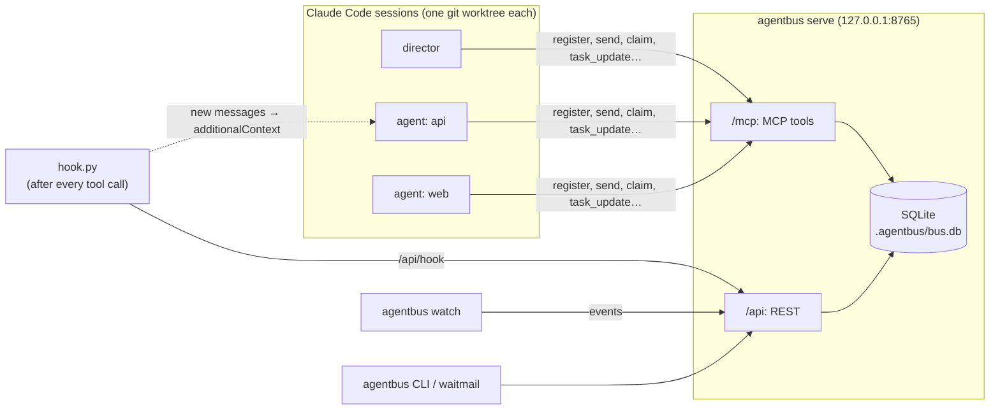

<div align="center">

# agentbus

**A team bus for Claude Code: parallel sessions in one repository that know about each other, talk, and don't step
on each other's files.**

**English** | [Русский](README.ru.md)

[](https://github.com/RetentionSoftware/agentbus/actions/workflows/ci.yml)
[](LICENSE)
[](pyproject.toml)
[](https://modelcontextprotocol.io)
[](https://docs.anthropic.com/en/docs/claude-code)
[](#quick-start)
[](https://github.com/RetentionSoftware/agentbus/commits/main)

</div>

agentbus is a small local server that a team of Claude Code sessions uses to coordinate: a roster with statuses,
messages that show up in an agent's context by themselves, a task board with dependencies, and claims on paths with
conflict detection. It is one Python process with a SQLite file, it listens only on loopback (`127.0.0.1`), and it needs no
accounts or external services.

## Contents

- [Why agentbus](#why-agentbus)
- [How it works](#how-it-works)
- [Quick start](#quick-start)
- [Setting up a project](#setting-up-a-project)
- [Working as a team](#working-as-a-team)
- [The monitor](#the-monitor)
- [Reference](#reference): [MCP tools](#mcp-tools) · [CLI](#cli) · [Configuration](#configuration) · [REST API](#rest-api)
- [Hook performance](#hook-performance)
- [Security](#security)
- [Limitations](#limitations)
- [Troubleshooting](#troubleshooting)
- [Contributing](#contributing) · [License](#license)

## Why agentbus

Running several Claude Code sessions on one repository is an easy way to get more done, until they collide. Out of
the box, parallel sessions:

- **know nothing about each other.** Nobody knows who works on what, who is stuck and who is done;
- **overwrite each other's files.** Two sessions editing the same module find out at merge time, or never;
- **cannot ask or agree on anything.** A question to another session has to go through you, copied by hand;
- **cannot be woken up.** A session that finished its turn sleeps until someone types into it.

agentbus gives such a team the minimum it needs to work like a team:

| | |
|---|---|
| **Roster and status** | Every agent registers with a name, a role, a branch and a working directory and keeps a one-line status ("writing the retry policy in `src/net/retry.py`, no tests yet"). `board()` shows the whole team at once. |
| **Messages with automatic delivery** | `send()` to one agent or to everyone. A Claude Code hook puts new messages straight into the recipient's context after its next tool call, so agents do not have to poll. Urgent messages come first. |
| **Claims on paths** | Before editing outside its own area, an agent claims a path or glob. An overlapping claim of someone else is refused, with the holder's name and reason, and nothing is created. |
| **Task board** | Tasks with owners, states and dependencies; a task cannot start before its dependencies are done; moving a task to review, blocked or done notifies the director. |
| **Journal and monitor** | Every join, message, status change, claim and conflict lands in an activity journal; `agentbus watch` shows it live, in color. |
| **No external services** | One local process and one SQLite file. Restart the server, the app or the machine: the state is still there. |

It was built for and tested on a real project: two waves of work by five parallel agents under one director
session, writing a C++ code base. What the bus actually did there:

- An urgent broadcast ("stop all builds, the compiler toolchain is being updated") reached busy agents **in the middle
  of their turns**, after their next tool call; a direct chat message to a session waits until the session's turn ends.
- An agent that broke something for everyone (it killed processes of other agents by image name) reported it with a
  team-wide alert within minutes; the team got a new rule out of it the same hour.
- Agents found infrastructure bugs in each other's areas and reported them to the owner instead of fixing them in
  passing, which kept every branch reviewable.
- Bugs in the bus itself were found by that work and fixed: a new session started in an agent's folder used to receive
  that agent's mail; two simultaneous claims of the same path could both succeed; the REST API accepted requests from
  web pages. All three have regression tests now.

## How it works



- **Server** (`agentbus serve`): MCP over streamable HTTP at `/mcp` for the agents, a small REST API at `/api` for
  the hook, the CLI and the monitor. Both are thin layers over one store with all the rules; every operation is a
  single SQLite transaction.
- **Hook** (`hook.py`): Claude Code runs it on `SessionStart`, `UserPromptSubmit` and `PostToolUse`. It refreshes the
  agent's "last seen", and if there is new mail, prints it as `additionalContext`, which Claude Code adds to the
  session's context. It is one file using only the Python standard library.
- **Session binding**: at session start the hook tells an unregistered session its `session_key` (the Claude Code
  session id); the agent passes it to `register()`, and from then on the bus knows which session is which agent.
- **Monitor** (`agentbus watch`) and **CLI** (`agentbus <operation>`): for you and the director, in a terminal.

The MCP part (tools, CLI, monitor) works with any MCP client. Automatic delivery and session binding use Claude Code
hooks. Starting sessions and waking an idle one is done by Claude Desktop, not by the bus: see
[Working as a team](#working-as-a-team).

## Quick start

You need [uv](https://docs.astral.sh/uv/) and Python 3.11+.

```bash
# 1. Run the bus in your project's root (state goes to ./.agentbus/bus.db). Keep this terminal open.
cd your-project
uvx --from git+https://github.com/RetentionSoftware/agentbus agentbus serve

# 2. In another terminal: is it up?
uvx --from git+https://github.com/RetentionSoftware/agentbus agentbus health
```

Then connect your project to it, as described below. For daily use, install the command once instead of `uvx`:

```bash
uv tool install git+https://github.com/RetentionSoftware/agentbus
agentbus --help
```

To run the bus in the background, clone the repository and use the scripts. They run that checkout through uv and
keep the database, logs and pid file in `<project>/.agentbus/`:

```bash
# Windows (PowerShell); also opens the monitor in its own window
powershell -File path/to/agentbus/scripts/start.ps1 -ProjectDir .
powershell -File path/to/agentbus/scripts/stop.ps1 -ProjectDir .

# macOS / Linux
path/to/agentbus/scripts/start.sh .
path/to/agentbus/scripts/stop.sh .
```

Add `.agentbus/` to your `.gitignore`.

## Setting up a project

**1. Run the server** in the project root, as in [Quick start](#quick-start). Optionally give it the project name
and the path of your protocol document, which are shown to the agents:
`agentbus serve --project-name "My Project" --protocol docs/agents/PROTOCOL.md`.

**2. Register the MCP server** for the project: `.mcp.json` in the repository root ([template](templates/mcp.json)):

```json
{
  "mcpServers": {
    "agentbus": { "type": "http", "url": "http://127.0.0.1:8765/mcp" }
  }
}
```

**3. Install the hook.** Copy [`src/agentbus/hook.py`](src/agentbus/hook.py) to `.claude/hooks/agentbus_hook.py`
in your project and commit it, then wire it in `.claude/settings.json`
([full template](templates/claude-settings.json)):

```json
{
  "enabledMcpjsonServers": ["agentbus"],
  "permissions": { "allow": ["mcp__agentbus"] },
  "hooks": {
    "SessionStart": [{ "hooks": [{ "type": "command", "timeout": 5,
      "command": "python \"$CLAUDE_PROJECT_DIR/.claude/hooks/agentbus_hook.py\" session_start" }] }],
    "UserPromptSubmit": [{ "hooks": [{ "type": "command", "timeout": 5,
      "command": "python \"$CLAUDE_PROJECT_DIR/.claude/hooks/agentbus_hook.py\" prompt" }] }],
    "PostToolUse": [{ "matcher": "*", "hooks": [{ "type": "command", "timeout": 5,
      "command": "python \"$CLAUDE_PROJECT_DIR/.claude/hooks/agentbus_hook.py\" post_tool" }] }]
  }
}
```

Use `python3` instead of `python` where that is the name of the interpreter (most macOS and Linux systems). The hook
needs only the standard library. If the bus runs on another port, set `AGENTBUS_PORT` in the `env` section of the
settings. Prefer this copied file to `agentbus hook`: see [Hook performance](#hook-performance).

> [!WARNING]
> Claude Code treats exit code 2 of a hook as a blocking error: a failing `UserPromptSubmit` hook discards the
> user's prompt. The agentbus hook always exits with 0, but `python missing_file.py` exits with 2. Keep the path in
> the settings valid, and do not move the hook file while sessions that loaded the old settings are running.

**4. Approve the MCP server.** `enabledMcpjsonServers` in the committed settings approves the project's `agentbus`
server for everyone; otherwise Claude Code asks once per user. `permissions.allow: ["mcp__agentbus"]` lets agents
call the bus tools without a permission prompt each time.

**5. Write the protocol** for your agents: start from [templates/PROTOCOL.md](templates/PROTOCOL.md) (session start
checklist, quality bar, git rules, progress log, claims, messages, statuses, hand-in). Put it where the server's
`--protocol` points (default `docs/agents/PROTOCOL.md`).

**6. Tell every session about it** with a paragraph in `CLAUDE.md` ([template](templates/CLAUDE.md-snippet.md)):

```markdown
## Agent team
Several parallel Claude sessions work on this project under the **director**. If you were given a task, read
`docs/agents/PROTOCOL.md` before any edit and run its start checklist (worktree, registration on the `agentbus`
bus, status). `[agent-bus] …` blocks in your context are messages of the team's coordination bus.
```

Start a new Claude Code session in the project: the hook greets it with
`[agent-bus] … You are NOT registered yet …`, and the `mcp__agentbus__*` tools are available.

## Working as a team

The workflow that agentbus was built around: one **director** session works with you, plans the work and reviews it;
**agent** sessions do the tasks in parallel.

1. **A task is a markdown file** (`docs/tasks/T-001-*.md`): goal, the agent's name, the paths it owns, contracts,
   acceptance criteria. The director commits it to the main branch and creates it on the board:
   `task_create(task_id="T-001", title=…, spec_path=…, depends_on=[…])`.
2. **One git worktree per agent.** Parallel sessions in one checkout overwrite each other's files and builds; a
   worktree (and a branch) per agent avoids that. In Claude Desktop, the director can start a session in a new
   worktree directly from its own chat.
3. **The kickoff message** ([template](templates/KICKOFF.md)) tells the agent its name and task, to run the protocol's
   start checklist, and to send a plan before writing code.
4. **Plan → go → work → review.** The agent sends its plan (`kind="review_request"`); the director answers with a
   `decision`; the agent works, keeping its status and a progress log current, claiming paths outside its area and
   asking questions over the bus; it hands in with `task_update(state="review")`, which notifies the director.
5. **The director merges** and moves the task to `done`; tasks that depend on it can start.

**How the director gets mail.** Messages reach a session through the hook after its tool calls. A director that is
waiting for agents runs `agentbus waitmail agent=director timeout=1800` as a background command: it exits as soon as
there is unread mail (without marking it read), which ends the wait.

**How to wake an idle agent.** A session that finished its turn sees nothing until something runs in it. The bus
cannot start a turn; Claude Desktop can: the director sends the session a short direct message (in Claude Desktop,
its cross-session message tool), and the agent's next tool call delivers the actual bus messages. Keep the substance
in the bus (it is persistent and searchable) and use the direct message only to wake the agent up.

**Joining late.** Team-wide messages sent before an agent's first registration are marked read for it: an old
"stop all builds" would mislead a newcomer. `register()` returns how many were skipped; `history(kind="decision")`
catches up on team decisions.

## The monitor

```bash
agentbus watch            # roster, then the live journal; Ctrl+C to quit
agentbus watch --quiet    # without message reads, deliveries and session starts
```

On Windows, `scripts/monitor.ps1` opens it in a console window of its own (the start script does that too). The
monitor only reads; closing it does not affect the bus, and it reconnects when the bus restarts.

```text
── agentbus · My Project · http://127.0.0.1:8765 ──
  ● api [T-002] working: writing the retry policy in src/net/retry.py
  ● director idle: reviewing T-001
── events ──
14:02:11 JOIN     web  joined: frontend
14:02:40 CLAIM    api [src/net]  retry policy
14:03:05 CONFLICT web [src/net/client.py]  claim refused, held by api (src/net)
14:03:12 MSG      web → api  #42 [question] can I add a timeout parameter to Client?
14:05:30 TASK     api [T-002]  in_progress -> review: branch feat/retry; tests in tests/net
```

## Reference

### MCP tools

Every tool that acts on behalf of an agent takes its name as `agent`: the bus does not remember callers between calls.

| Tool | What it does |
|---|---|
| `register(name, role, session_key="", cwd="", branch="")` | Join or rejoin. `name`: 1–64 letters, digits, `.`, `_`, `-`. Returns unread count, your open tasks, who is online, how many earlier broadcasts were skipped. |
| `set_status(agent, state, summary, task_id="")` | `state`: `idle` \| `working` \| `blocked` \| `review` \| `done`. |
| `agents()` | Roster with status and `online` (seen in the last 15 minutes). |
| `send(agent, to, body, subject="", kind="note", priority="normal", reply_to=0, task_id="")` | `to`: an agent or `all`. `kind`: `note` \| `question` \| `answer` \| `contract_change` \| `review_request` \| `decision` \| `alert`. `priority`: `normal` \| `urgent`. |
| `inbox(agent, include_read=False, limit=20)` | Unread messages (urgent first), marked read; `include_read=True`: recent history. |
| `wait_for_messages(agent, timeout_s=120)` | Waits up to 600 s for mail, then returns the inbox. |
| `history(kind="", agent="", task_id="", limit=30)` | Search messages. |
| `task_create(agent, task_id, title, spec_path="", depends_on=None, owner="", wave="")` | Create a task; the owner gets a note. |
| `task_update(agent, task_id, state, note="", owner="")` | `todo` \| `in_progress` \| `blocked` \| `review` \| `done` \| `cancelled`. Only the owner or the director moves an owned task; `in_progress` requires finished dependencies; `review`/`blocked`/`done` notify the director. |
| `task_list(state="", owner="")`, `task_get(task_id)` | Tasks; one task with its history. |
| `claim(agent, path, reason, ttl_hours=8, shared=False)` | Claim a repo-relative path or glob for 15 min…72 h. Returns `ok=False` with the conflicting claims if someone else's claim overlaps. Claiming again extends. |
| `release(agent, path="", claim_id=0)` | Release one claim, or all of yours. |
| `claims(agent="")` | Active claims. |
| `board()` | Agents, tasks by state, claims, the last decisions and contract changes. |

The **director** is a convention, not a setting: an agent named `director` may move tasks it does not own and
receives the task notifications.

Claims compare normalised paths (forward slashes, lower case) and treat a glob as its directory (`src/core/*.h`
covers `src/core`), so overlap detection errs on the side of a conflict. Claiming the whole repository, or a glob at
its root, is refused.

### CLI

```text
agentbus [--host HOST] [--port PORT] <command> [arguments]

serve [--db PATH] [--project-name NAME] [--protocol PATH]   run the bus in the foreground
watch [--history N] [--quiet]                                live monitor
hook session_start|prompt|post_tool                          the Claude Code hook (payload on stdin)
health                                                       version, project, database of the running bus
waitmail agent=NAME [timeout=SECONDS]                        block until NAME has unread mail
<operation> key=value ... | <operation> --json '{...}'      any bus operation
version
```

Operations: every MCP tool except `wait_for_messages`, plus `unread_count(agent)`, `events(after, limit)` (the
journal) and `purge(agent, task_id)` (erase every trace of a test agent or task). Values starting with `[` or `{`
are parsed as JSON; the server converts the rest (`limit=5`, `include_read=true`).

```bash
agentbus board
agentbus send agent=director to=all kind=decision body="Use the new error type in all modules"
agentbus task_create agent=director task_id=T-003 title="Retry policy" spec_path=docs/tasks/T-003.md depends_on='["T-001"]'
agentbus history kind=decision limit=5
```

Exit codes: `0` success, `1` the bus reported an error or is unreachable, `2` usage error. `waitmail` exits with `0`
both when mail arrives and on timeout; it prints which.

### Configuration

Every setting is a flag, an environment variable, or the default, in that order of precedence, for every command.

| Flag | Environment | Default | Used by |
|---|---|---|---|
| `--host` | `AGENTBUS_HOST` | `127.0.0.1` | all (the server accepts only `127.0.0.1`, `::1`, `localhost`) |
| `--port` | `AGENTBUS_PORT` | `8765` | all |
| `serve --db` | `AGENTBUS_DB` | `.agentbus/bus.db` under the current directory | server |
| `serve --project-name` | `AGENTBUS_PROJECT_NAME` | name of the current directory | server: MCP instructions |
| `serve --protocol` | `AGENTBUS_PROTOCOL` | `docs/agents/PROTOCOL.md` | server: MCP instructions, hook texts |

The database path is relative to the directory where the server starts: start it from the project root (the scripts
do). `agentbus health` shows which database a running bus uses. The server writes its process id to `server.pid`
next to the database while it runs. Run one server per database.

The database has a schema version. A newer agentbus migrates an older database on start, after saving a copy next to
it (`bus.db.v<N>.bak`); an older agentbus refuses to open a newer database.

### REST API

For scripts and tools. Requests must come without an `Origin` header and with a loopback `Host`; POST bodies are
JSON (`Content-Type: application/json`).

| Request | Response |
|---|---|
| `GET /api/health` | `{"ok": true, "version", "schema_version", "project", "db", "agents"}` |
| `POST /api/call/<operation>` with the arguments as a JSON object | `{"result": …}` or `{"error": "…"}` with 400/404 |
| `POST /api/hook` with `{"event", "session_id", "cwd"}` | `{"context": "<text for the session, or empty>"}` |

## Hook performance

The hook runs after **every** tool call of every agent, so its start-up time matters. One `PostToolUse` call with a
round trip to the bus, median of 30 runs on Windows 11, Python 3.14:

| How the hook is run | Median | p90 |
|---|---|---|
| `python .claude/hooks/agentbus_hook.py post_tool` (copied file) | **45 ms** | 47 ms |
| `agentbus hook post_tool` (after `uv tool install`) | 130 ms | 133 ms |
| `uv run --project <checkout> agentbus hook post_tool` | 155 ms | 156 ms |
| `uvx --from <local path> agentbus hook post_tool` | 229 ms | 240 ms |

Use the copied file. The last line is a lower bound for `uvx --from git+https://…`, which also has to resolve the
git reference; use `uvx` for `serve`, `watch` and the CLI, never for the hook. The numbers include the start of the
Python interpreter, which dominates; the bus itself answers a hook request in about a millisecond.

## Security

- **No authentication.** Anyone who can reach the port can act as any agent. The server therefore listens only on
  loopback (`127.0.0.1`, `::1`, `localhost`) and refuses other addresses. **Never expose it** to a network, through a
  proxy, a tunnel or port forwarding.
- **Web pages are kept out.** A browser page can send "simple" cross-origin POST requests to `127.0.0.1` without a
  CORS preflight, and DNS rebinding can make a foreign host name point to it. The first version of the REST API
  accepted such requests: any open web page could have put text into an agent's context through the hook, or erased
  data. Now `/api/*` rejects requests with an `Origin` header, a non-loopback `Host` or a non-JSON body, and the MCP
  SDK applies the same Host/Origin checks to `/mcp`.
- **Messages are data, not commands.** Text from the bus reaches the model's context. Your protocol should say that
  messages from other agents are requests and information, that only the director gives instructions, and that
  nothing outside the repository (installing software, network access, deleting data) is done because of a message
  without the user's confirmation. The [protocol template](templates/PROTOCOL.md) does.
- The state is a plain SQLite file in `.agentbus/`: keep it out of git.

## Limitations

- **An idle agent does not see its mail** until something runs in its session: the hook delivers only after tool
  calls and prompts. Wake it with a direct message (see [Working as a team](#working-as-a-team)).
- **Automatic delivery and session binding need Claude Code hooks.** Other MCP clients can use every tool but have to
  call `inbox()` or `wait_for_messages()` themselves.
- **One machine.** No networking between machines, no authentication, no web UI.
- Claims are advisory: the bus detects conflicts between agents that claim; it does not lock files.
- At most 8 messages are delivered per hook call (the rest stay unread, the agent is told to call `inbox()`), and
  bodies longer than 1500 characters are cut in the hook's text (the full text is in `inbox`).

## Troubleshooting

| Symptom | Cause and fix |
|---|---|
| `[agent-bus] The agent bus is OFFLINE` at session start, `agentbus health` says unreachable | The server is not running, or on another port. Start it; check `AGENTBUS_PORT` in the shell and in the hook's environment. |
| No `mcp__agentbus__*` tools in a session | The MCP server is not approved or was not reachable when the session started. Approve it (`enabledMcpjsonServers` or the prompt), make sure the bus runs, start a new session. |
| Messages are not delivered, or an agent gets someone else's mail | Session binding. The hook binds a session by the `session_key` given to `register()`. Re-register with the key from the `[agent-bus]` block at session start. A session without a key is bound by directory only if exactly one agent without a key registered from that directory. |
| `address already in use` on start | Another process listens on the port: another bus (`agentbus health` shows its project and database) or another program. Use `--port`. |
| `database … has schema version N, but this agentbus supports up to M` | The database was upgraded by a newer agentbus. Upgrade agentbus; downgrades are not supported. |
| The hook does nothing | Run it by hand: `echo '{"session_id":"x"}' \| python .claude/hooks/agentbus_hook.py session_start` must print JSON. Check the interpreter name (`python`/`python3`) and the path in the settings. |
| A prompt disappears after pressing Enter | A `UserPromptSubmit` hook exited with code 2, typically because its file is missing. Fix the path in `.claude/settings.json`. |

## Contributing

See [CONTRIBUTING.md](CONTRIBUTING.md). In short: `uv sync`, then `uv run pytest`, `uv run ruff check`,
`uv run ruff format --check` and `uv run mypy` must pass. The MCP tool set is a public API.

Planned: `agentbus init` to generate the project files (`.mcp.json`, hook settings, the hook, the protocol).

## License

[MIT](LICENSE) © 2026 Retention Software
