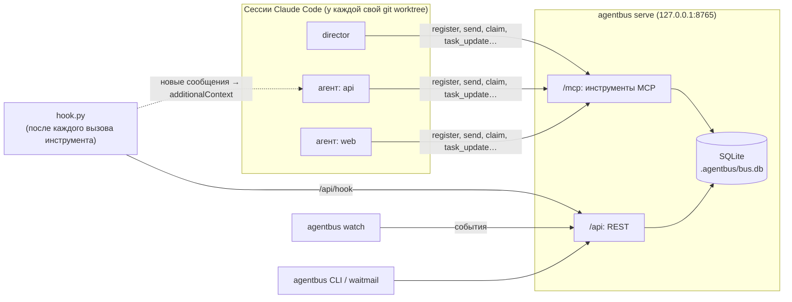

<div align="center">

# agentbus

**Шина команды для Claude Code: параллельные сессии в одном репозитории знают друг о друге, переписываются и не
затирают чужие файлы.**

[English](README.md) | **Русский**

[](https://github.com/RetentionSoftware/agentbus/actions/workflows/ci.yml)
[](LICENSE)
[](pyproject.toml)
[](https://modelcontextprotocol.io)
[](https://docs.anthropic.com/en/docs/claude-code)
[](#быстрый-старт)
[](https://github.com/RetentionSoftware/agentbus/commits/main)

</div>

agentbus — небольшой локальный сервер, через который команда сессий Claude Code координирует работу: реестр со
статусами, сообщения, которые сами попадают в контекст агента, доска задач с зависимостями и захваты путей с
обнаружением конфликтов. Это один процесс Python и один файл SQLite; сервер слушает только loopback (`127.0.0.1`)
и не требует ни учётных записей, ни внешних сервисов.

## Содержание

- [Зачем это нужно](#зачем-это-нужно)
- [Как устроено](#как-устроено)
- [Быстрый старт](#быстрый-старт)
- [Настройка проекта](#настройка-проекта)
- [Работа командой](#работа-командой)
- [Монитор](#монитор)
- [Справочник](#справочник): [инструменты MCP](#инструменты-mcp) · [CLI](#cli) · [конфигурация](#конфигурация) · [REST API](#rest-api)
- [Скорость хука](#скорость-хука)
- [Безопасность](#безопасность)
- [Ограничения](#ограничения)
- [Устранение неполадок](#устранение-неполадок)
- [Участие в разработке](#участие-в-разработке) · [Лицензия](#лицензия)

## Зачем это нужно

Несколько сессий Claude Code над одним репозиторием — простой способ сделать больше, пока они не начинают
сталкиваться. Без дополнительных средств параллельные сессии:

- **ничего не знают друг о друге.** Никто не знает, кто над чем работает, кто застрял и кто закончил;
- **затирают чужие файлы.** Две сессии, правящие один модуль, узнают об этом при слиянии — или не узнают вовсе;
- **не могут спросить и договориться.** Вопрос другой сессии приходится передавать через вас, копируя руками;
- **не просыпаются сами.** Сессия, закончившая ход, спит, пока в неё что-нибудь не напишут.

agentbus даёт такой команде минимум, нужный для работы командой:

| | |
|---|---|
| **Реестр и статусы** | Каждый агент регистрируется с именем, ролью, веткой и рабочим каталогом и держит статус в одну строку («пишу политику повторов в `src/net/retry.py`, тестов ещё нет»). `board()` показывает всю команду сразу. |
| **Сообщения с автодоставкой** | `send()` одному агенту или всем. Хук Claude Code кладёт новые сообщения прямо в контекст получателя после его следующего вызова инструмента — опрашивать почту не нужно. Срочные идут первыми. |
| **Захваты путей** | Прежде чем править что-то вне своей зоны, агент захватывает путь или glob. Пересекающийся чужой захват отклоняется с именем владельца и причиной, и ничего не создаётся. |
| **Доска задач** | Задачи с владельцами, состояниями и зависимостями; задачу нельзя начать, пока не готовы зависимости; переход в review, blocked или done уведомляет director. |
| **Журнал и монитор** | Каждая регистрация, сообщение, смена статуса, захват и конфликт попадают в журнал событий; `agentbus watch` показывает его вживую, в цвете. |
| **Никаких внешних сервисов** | Один локальный процесс и один файл SQLite. Перезапустите сервер, приложение или машину — состояние на месте. |

Шина написана для реального проекта и проверена на нём: две волны работы пяти параллельных агентов под управлением
одной сессии director, кодовая база на C++. Что шина там на деле сделала:

- Срочное широковещательное сообщение («остановите все сборки, обновляется тулчейн компилятора») дошло до занятых
  агентов **посреди их хода**, после следующего вызова инструмента; прямое сообщение в чат сессии ждёт конца её хода.
- Агент, который сломал что-то всем (завершил процессы других агентов по имени образа), сообщил об этом
  широковещательным alert в течение минут; в тот же час у команды появилось новое правило.
- Агенты находили инфраструктурные баги в чужих зонах и сообщали владельцу, а не чинили попутно, поэтому каждую
  ветку можно было нормально отревьюить.
- В ходе этой работы нашлись и исправлены баги самой шины: новая сессия, открытая в папке агента, получала его почту;
  два одновременных захвата одного пути могли пройти оба; REST API принимал запросы от веб-страниц. На все три теперь
  есть регрессионные тесты.

## Как устроено



- **Сервер** (`agentbus serve`): MCP поверх streamable HTTP на `/mcp` для агентов и небольшой REST API на `/api` для
  хука, CLI и монитора. Оба — тонкие слои над одним хранилищем, где живут все правила; каждая операция — одна
  транзакция SQLite.
- **Хук** (`hook.py`): Claude Code запускает его на `SessionStart`, `UserPromptSubmit` и `PostToolUse`. Он обновляет
  «последний раз видели» агента и, если есть новая почта, печатает её как `additionalContext`, который Claude Code
  добавляет в контекст сессии. Это один файл только на стандартной библиотеке Python.
- **Привязка сессии**: при старте сессии хук сообщает незарегистрированной сессии её `session_key` (id сессии Claude
  Code); агент передаёт его в `register()`, и с этого момента шина знает, какая сессия — какой агент.
- **Монитор** (`agentbus watch`) и **CLI** (`agentbus <операция>`): для вас и director, в терминале.

MCP-часть (инструменты, CLI, монитор) работает с любым MCP-клиентом. Автодоставка и привязка сессии используют хуки
Claude Code. Запускать сессии и будить неактивную умеет Claude Desktop, а не шина: см.
[Работа командой](#работа-командой).

## Быстрый старт

Нужны [uv](https://docs.astral.sh/uv/) и Python 3.11+.

```bash
# 1. Запустите шину в корне проекта (состояние — в ./.agentbus/bus.db). Оставьте этот терминал открытым.
cd your-project
uvx --from git+https://github.com/RetentionSoftware/agentbus agentbus serve

# 2. В другом терминале: работает?
uvx --from git+https://github.com/RetentionSoftware/agentbus agentbus health
```

Затем подключите к ней проект, как описано ниже. Для ежедневной работы вместо `uvx` один раз установите команду:

```bash
uv tool install git+https://github.com/RetentionSoftware/agentbus
agentbus --help
```

Чтобы шина работала в фоне, клонируйте репозиторий и пользуйтесь скриптами. Они запускают этот клон через uv и
держат базу, логи и pid-файл в `<проект>/.agentbus/`:

```bash
# Windows (PowerShell); заодно открывает монитор в отдельном окне
powershell -File path/to/agentbus/scripts/start.ps1 -ProjectDir .
powershell -File path/to/agentbus/scripts/stop.ps1 -ProjectDir .

# macOS / Linux
path/to/agentbus/scripts/start.sh .
path/to/agentbus/scripts/stop.sh .
```

Добавьте `.agentbus/` в `.gitignore`.

## Настройка проекта

**1. Запустите сервер** в корне проекта, как в [Быстром старте](#быстрый-старт). По желанию передайте ему имя
проекта и путь к документу протокола — их увидят агенты:
`agentbus serve --project-name "My Project" --protocol docs/agents/PROTOCOL.md`.

**2. Зарегистрируйте MCP-сервер** для проекта: `.mcp.json` в корне репозитория ([шаблон](templates/mcp.json)):

```json
{
  "mcpServers": {
    "agentbus": { "type": "http", "url": "http://127.0.0.1:8765/mcp" }
  }
}
```

**3. Установите хук.** Скопируйте [`src/agentbus/hook.py`](src/agentbus/hook.py) в `.claude/hooks/agentbus_hook.py`
вашего проекта и закоммитьте, затем подключите его в `.claude/settings.json`
([полный шаблон](templates/claude-settings.json)):

```json
{
  "enabledMcpjsonServers": ["agentbus"],
  "permissions": { "allow": ["mcp__agentbus"] },
  "hooks": {
    "SessionStart": [{ "hooks": [{ "type": "command", "timeout": 5,
      "command": "python \"$CLAUDE_PROJECT_DIR/.claude/hooks/agentbus_hook.py\" session_start" }] }],
    "UserPromptSubmit": [{ "hooks": [{ "type": "command", "timeout": 5,
      "command": "python \"$CLAUDE_PROJECT_DIR/.claude/hooks/agentbus_hook.py\" prompt" }] }],
    "PostToolUse": [{ "matcher": "*", "hooks": [{ "type": "command", "timeout": 5,
      "command": "python \"$CLAUDE_PROJECT_DIR/.claude/hooks/agentbus_hook.py\" post_tool" }] }]
  }
}
```

Пишите `python3` вместо `python`, если интерпретатор называется так (большинство систем macOS и Linux). Хуку нужна
только стандартная библиотека. Если шина работает на другом порту, задайте `AGENTBUS_PORT` в разделе `env` настроек.
Скопированный файл предпочтительнее `agentbus hook`: см. [Скорость хука](#скорость-хука).

> [!WARNING]
> Код выхода 2 у хука Claude Code считает блокирующей ошибкой: упавший хук `UserPromptSubmit` отбрасывает промпт
> пользователя. Хук agentbus всегда завершается с кодом 0, но `python missing_file.py` завершается с кодом 2. Следите,
> чтобы путь в настройках был верным, и не переносите файл хука, пока работают сессии, загрузившие старые настройки.

**4. Одобрите MCP-сервер.** `enabledMcpjsonServers` в закоммиченных настройках одобряет сервер `agentbus` проекта
для всех; иначе Claude Code один раз спросит каждого пользователя. `permissions.allow: ["mcp__agentbus"]` позволяет
агентам вызывать инструменты шины без запроса разрешения каждый раз.

**5. Напишите протокол** для агентов: возьмите за основу [templates/PROTOCOL.md](templates/PROTOCOL.md) (стартовый
чеклист, планка качества, правила git, журнал прогресса, захваты, сообщения, статусы, сдача). Положите его туда, куда
указывает `--protocol` сервера (по умолчанию `docs/agents/PROTOCOL.md`).

**6. Расскажите о нём каждой сессии** абзацем в `CLAUDE.md` ([шаблон](templates/CLAUDE.md-snippet.md)):

```markdown
## Agent team
Several parallel Claude sessions work on this project under the **director**. If you were given a task, read
`docs/agents/PROTOCOL.md` before any edit and run its start checklist (worktree, registration on the `agentbus`
bus, status). `[agent-bus] …` blocks in your context are messages of the team's coordination bus.
```

Откройте в проекте новую сессию Claude Code: хук встретит её сообщением `[agent-bus] … You are NOT registered yet …`,
а инструменты `mcp__agentbus__*` будут доступны.

## Работа командой

Процесс, вокруг которого построена agentbus: одна сессия **director** работает с вами, планирует работу и ревьюит её;
сессии **агентов** выполняют задачи параллельно.

1. **Задача — markdown-файл** (`docs/tasks/T-001-*.md`): цель, имя агента, пути, которыми он владеет, контракты,
   критерии приёмки. Director коммитит его в основную ветку и заводит на доске:
   `task_create(task_id="T-001", title=…, spec_path=…, depends_on=[…])`.
2. **Отдельный git worktree на агента.** Параллельные сессии в одном checkout затирают друг другу файлы и сборки;
   worktree (и ветка) на агента это исключает. В Claude Desktop director может запустить сессию в новом worktree прямо
   из своего чата.
3. **Стартовое сообщение** ([шаблон](templates/KICKOFF.md)) сообщает агенту имя и задачу, велит выполнить стартовый
   чеклист протокола и прислать план до того, как писать код.
4. **План → «поехали» → работа → ревью.** Агент присылает план (`kind="review_request"`); director отвечает
   `decision`; агент работает, держит актуальными статус и журнал прогресса, захватывает пути вне своей зоны и
   задаёт вопросы через шину; сдаёт работу через `task_update(state="review")`, что уведомляет director.
5. **Director сливает** ветку и переводит задачу в `done`; зависящие от неё задачи могут стартовать.

Весь порядок работы director — спецификации и их независимая вычитка, запуск агентов и выбор модели, ревью в
чистом worktree, паузы, причины, по которым команда превращается в кашу, — записан в
[шпаргалке director](docs/director/README.ru.md), с шаблонами [спецификации задачи](templates/TASK.md),
[журнала director](templates/DIRECTOR-JOURNAL.md) и [чеклиста ревью](templates/REVIEW-CHECKLIST.md).

**Как director получает почту.** Сообщения доходят до сессии через хук после её вызовов инструментов. Director,
который ждёт агентов, запускает фоном `agentbus waitmail agent=director timeout=1800`: команда завершается, как только
есть непрочитанная почта (не помечая её прочитанной), и это прерывает ожидание.

**Как разбудить неактивного агента.** Сессия, закончившая ход, ничего не видит, пока в ней что-нибудь не запустится.
Шина не умеет начинать ход; Claude Desktop умеет: director отправляет сессии короткое прямое сообщение (в Claude
Desktop — его инструментом сообщений между сессиями), и следующий вызов инструмента агента доставит ему сообщения
шины. Суть держите в шине (она постоянная и в ней есть поиск), а прямое сообщение используйте только как будильник.

**Позднее подключение.** Широковещательные сообщения, отправленные до первой регистрации агента, помечаются для него
прочитанными: старое «остановите все сборки» сбило бы новичка с толку. `register()` возвращает, сколько их пропущено;
`history(kind="decision")` позволяет догнать решения команды.

## Монитор

```bash
agentbus watch            # реестр, затем живой журнал; Ctrl+C — выход
agentbus watch --quiet    # без прочтений, доставок и стартов сессий
```

В Windows `scripts/monitor.ps1` открывает его в отдельном окне консоли (скрипт запуска делает это тоже). Монитор
только читает; закрытие окна не влияет на шину, а после перезапуска шины он переподключается сам.

```text
── agentbus · My Project · http://127.0.0.1:8765 ──
  ● api [T-002] working: writing the retry policy in src/net/retry.py
  ● director idle: reviewing T-001
── events ──
14:02:11 JOIN     web  joined: frontend
14:02:40 CLAIM    api [src/net]  retry policy
14:03:05 CONFLICT web [src/net/client.py]  claim refused, held by api (src/net)
14:03:12 MSG      web → api  #42 [question] can I add a timeout parameter to Client?
14:05:30 TASK     api [T-002]  in_progress -> review: branch feat/retry; tests in tests/net
```

## Справочник

### Инструменты MCP

Каждый инструмент, действующий от имени агента, принимает его имя в `agent`: между вызовами шина не помнит, кто
звонит.

| Инструмент | Что делает |
|---|---|
| `register(name, role, session_key="", cwd="", branch="")` | Войти или перерегистрироваться. `name`: 1–64 символа из букв, цифр, `.`, `_`, `-`. Возвращает число непрочитанных, ваши открытые задачи, кто онлайн, сколько ранних широковещательных сообщений пропущено. |
| `set_status(agent, state, summary, task_id="")` | `state`: `idle` \| `working` \| `blocked` \| `review` \| `done`. |
| `agents()` | Реестр со статусами и `online` (виден в последние 15 минут). |
| `send(agent, to, body, subject="", kind="note", priority="normal", reply_to=0, task_id="")` | `to`: агент или `all`. `kind`: `note` \| `question` \| `answer` \| `contract_change` \| `review_request` \| `decision` \| `alert`. `priority`: `normal` \| `urgent`. |
| `inbox(agent, include_read=False, limit=20)` | Непрочитанные (срочные первыми), помечаются прочитанными; `include_read=True` — недавняя история. |
| `wait_for_messages(agent, timeout_s=120)` | Ждёт почту до 600 с, затем возвращает inbox. |
| `history(kind="", agent="", task_id="", limit=30)` | Поиск по сообщениям. |
| `task_create(agent, task_id, title, spec_path="", depends_on=None, owner="", wave="")` | Создать задачу; владелец получает уведомление. |
| `task_update(agent, task_id, state, note="", owner="")` | `todo` \| `in_progress` \| `blocked` \| `review` \| `done` \| `cancelled`. Задачу с владельцем двигает только владелец или director; `in_progress` требует готовых зависимостей; `review`/`blocked`/`done` уведомляют director. |
| `task_list(state="", owner="")`, `task_get(task_id)` | Задачи; одна задача с историей. |
| `claim(agent, path, reason, ttl_hours=8, shared=False)` | Захватить путь или glob относительно репозитория на 15 мин…72 ч. Возвращает `ok=False` со списком конфликтов, если пересекается чужой захват. Повторный захват продлевает. |
| `release(agent, path="", claim_id=0)` | Снять один захват или все свои. |
| `claims(agent="")` | Активные захваты. |
| `board()` | Агенты, задачи по состояниям, захваты, последние решения и изменения контрактов. |

**Director** — соглашение, а не настройка: агент с именем `director` может двигать чужие задачи и получает
уведомления о задачах.

Захваты сравнивают нормализованные пути (прямые слэши, нижний регистр) и считают glob его каталогом
(`src/core/*.h` покрывает `src/core`), так что при сомнении шина выбирает конфликт. Захват всего репозитория или glob
в его корне отклоняется.

### CLI

```text
agentbus [--host HOST] [--port PORT] <команда> [аргументы]

serve [--db PATH] [--project-name NAME] [--protocol PATH]   запустить шину на переднем плане
watch [--history N] [--quiet]                                живой монитор
hook session_start|prompt|post_tool                          хук Claude Code (payload на stdin)
health                                                       версия, проект и БД работающей шины
waitmail agent=NAME [timeout=SECONDS]                        ждать, пока у NAME появится непрочитанная почта
<операция> key=value ... | <операция> --json '{...}'         любая операция шины
version
```

Операции: все инструменты MCP, кроме `wait_for_messages`, плюс `unread_count(agent)`, `events(after, limit)` (журнал)
и `purge(agent, task_id)` (стереть все следы тестового агента или задачи). Значения, начинающиеся с `[` или `{`,
разбираются как JSON; остальное сервер приводит к нужному типу сам (`limit=5`, `include_read=true`).

```bash
agentbus board
agentbus send agent=director to=all kind=decision body="Use the new error type in all modules"
agentbus task_create agent=director task_id=T-003 title="Retry policy" spec_path=docs/tasks/T-003.md depends_on='["T-001"]'
agentbus history kind=decision limit=5
```

Коды выхода: `0` — успех, `1` — шина вернула ошибку или недоступна, `2` — ошибка в аргументах. `waitmail` завершается
с `0` и когда пришла почта, и по таймауту; что именно произошло, он печатает.

### Конфигурация

Любая настройка задаётся флагом, переменной окружения или берётся по умолчанию — именно в таком порядке приоритета,
для всех команд.

| Флаг | Окружение | По умолчанию | Кто использует |
|---|---|---|---|
| `--host` | `AGENTBUS_HOST` | `127.0.0.1` | все (сервер принимает только `127.0.0.1`, `::1`, `localhost`) |
| `--port` | `AGENTBUS_PORT` | `8765` | все |
| `serve --db` | `AGENTBUS_DB` | `.agentbus/bus.db` в текущем каталоге | сервер |
| `serve --project-name` | `AGENTBUS_PROJECT_NAME` | имя текущего каталога | сервер: инструкции MCP |
| `serve --protocol` | `AGENTBUS_PROTOCOL` | `docs/agents/PROTOCOL.md` | сервер: инструкции MCP, тексты хука |

Путь к базе отсчитывается от каталога, где запущен сервер: запускайте его из корня проекта (скрипты так и делают).
`agentbus health` показывает, какую базу использует работающая шина. Пока сервер работает, он пишет id своего
процесса в `server.pid` рядом с базой. Один сервер — одна база.

У базы есть версия схемы. Более новая agentbus при старте мигрирует старую базу, предварительно сохранив рядом копию
(`bus.db.v<N>.bak`); более старая agentbus отказывается открывать более новую базу.

### REST API

Для скриптов и инструментов. Запросы должны приходить без заголовка `Origin` и с loopback-значением `Host`; тело
POST — JSON (`Content-Type: application/json`).

| Запрос | Ответ |
|---|---|
| `GET /api/health` | `{"ok": true, "version", "schema_version", "project", "db", "agents"}` |
| `POST /api/call/<операция>` с аргументами в виде JSON-объекта | `{"result": …}` или `{"error": "…"}` с кодом 400/404 |
| `POST /api/hook` с `{"event", "session_id", "cwd"}` | `{"context": "<текст для сессии или пусто>"}` |

## Скорость хука

Хук запускается после **каждого** вызова инструмента каждым агентом, поэтому время его старта важно. Один вызов
`PostToolUse` с обращением к шине, медиана 30 запусков, Windows 11, Python 3.14:

| Как запускается хук | Медиана | p90 |
|---|---|---|
| `python .claude/hooks/agentbus_hook.py post_tool` (скопированный файл) | **45 мс** | 47 мс |
| `agentbus hook post_tool` (после `uv tool install`) | 130 мс | 133 мс |
| `uv run --project <клон> agentbus hook post_tool` | 155 мс | 156 мс |
| `uvx --from <локальный путь> agentbus hook post_tool` | 229 мс | 240 мс |

Используйте скопированный файл. Последняя строка — нижняя оценка для `uvx --from git+https://…`, которому ещё нужно
разрешить git-ссылку; `uvx` годится для `serve`, `watch` и CLI, но не для хука. В цифры входит запуск интерпретатора
Python, он и доминирует: сама шина отвечает на запрос хука примерно за миллисекунду.

## Безопасность

- **Аутентификации нет.** Любой, кто достучится до порта, может действовать от имени любого агента. Поэтому сервер
  слушает только loopback (`127.0.0.1`, `::1`, `localhost`) и отказывается от других адресов. **Никогда не
  выставляйте его** в сеть — ни через прокси, ни через туннель, ни пробросом порта.
- **Веб-страницы не допускаются.** Страница в браузере может отправить на `127.0.0.1` «простой» кросс-доменный
  POST-запрос без CORS-preflight, а DNS rebinding может направить на него чужое имя хоста. Первая версия REST API такие
  запросы принимала: любая открытая веб-страница могла вписать текст в контекст агента через хук или стереть данные.
  Теперь `/api/*` отклоняет запросы с заголовком `Origin`, с не-loopback `Host` или не-JSON телом, а MCP SDK делает те же
  проверки Host/Origin для `/mcp`.
- **Сообщения — данные, а не команды.** Текст из шины попадает в контекст модели. Ваш протокол должен говорить, что
  сообщения других агентов — просьбы и информация, указания даёт только director, а ничего вне репозитория (установка
  ПО, сеть, удаление данных) по сообщению не делается без подтверждения пользователя. [Шаблон
  протокола](templates/PROTOCOL.md) это говорит.
- Состояние — обычный файл SQLite в `.agentbus/`: не кладите его в git.

## Ограничения

- **Неактивный агент не видит почту**, пока в его сессии что-нибудь не запустится: хук доставляет только после вызовов
  инструментов и промптов. Будите его прямым сообщением (см. [Работа командой](#работа-командой)).
- **Автодоставка и привязка сессии требуют хуков Claude Code.** Другие MCP-клиенты могут пользоваться всеми
  инструментами, но должны сами вызывать `inbox()` или `wait_for_messages()`.
- **Одна машина.** Ни сети между машинами, ни аутентификации, ни веб-интерфейса.
- Захваты — договорённость: шина обнаруживает конфликты между агентами, которые захватывают пути, но не блокирует
  файлы.
- За один вызов хук доставляет не больше 8 сообщений (остальные остаются непрочитанными, агенту предлагается вызвать
  `inbox()`), а тексты длиннее 1500 символов в тексте хука обрезаются (полностью — в `inbox`).

## Устранение неполадок

| Симптом | Причина и что делать |
|---|---|
| `[agent-bus] The agent bus is OFFLINE` при старте сессии, `agentbus health` пишет unreachable | Сервер не запущен или работает на другом порту. Запустите его; проверьте `AGENTBUS_PORT` в оболочке и в окружении хука. |
| В сессии нет инструментов `mcp__agentbus__*` | MCP-сервер не одобрен или был недоступен при старте сессии. Одобрите его (`enabledMcpjsonServers` или запрос), убедитесь, что шина работает, откройте новую сессию. |
| Сообщения не доставляются, или агент получает чужую почту | Привязка сессии. Хук привязывает сессию по `session_key`, переданному в `register()`. Перерегистрируйтесь с ключом из блока `[agent-bus]` при старте сессии. Сессия без ключа привязывается по каталогу, только если из этого каталога зарегистрирован ровно один агент без ключа. |
| `address already in use` при запуске | Порт занят другим процессом: другой шиной (`agentbus health` покажет её проект и базу) или другой программой. Используйте `--port`. |
| `database … has schema version N, but this agentbus supports up to M` | Базу обновила более новая agentbus. Обновите agentbus; понижение версии не поддерживается. |
| Хук ничего не делает | Запустите его руками: `echo '{"session_id":"x"}' \| python .claude/hooks/agentbus_hook.py session_start` должен напечатать JSON. Проверьте имя интерпретатора (`python`/`python3`) и путь в настройках. |
| Промпт пропадает после Enter | Хук `UserPromptSubmit` завершился с кодом 2 — обычно потому, что его файла нет. Исправьте путь в `.claude/settings.json`. |

## Участие в разработке

См. [CONTRIBUTING.md](CONTRIBUTING.md). Коротко: `uv sync`, затем должны проходить `uv run pytest`,
`uv run ruff check`, `uv run ruff format --check` и `uv run mypy`. Набор инструментов MCP — публичный API.

В планах: `agentbus init` — генерация файлов проекта (`.mcp.json`, настройки хуков, хук, протокол).

## Лицензия

[MIT](LICENSE) © 2026 Retention Software
